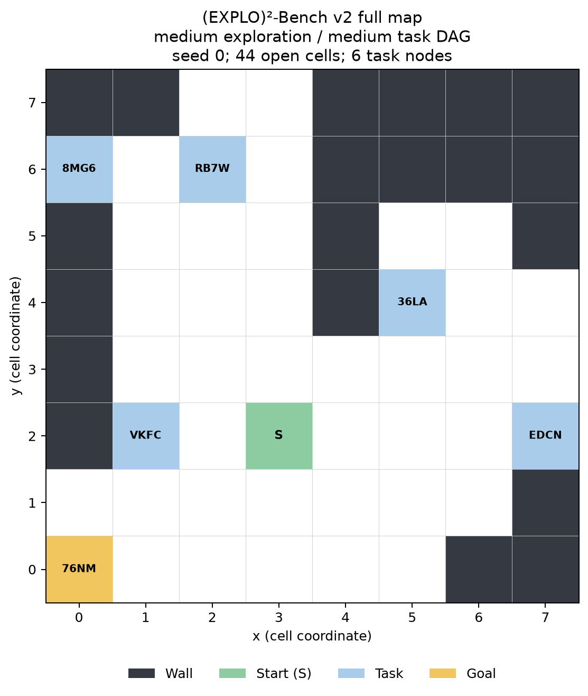
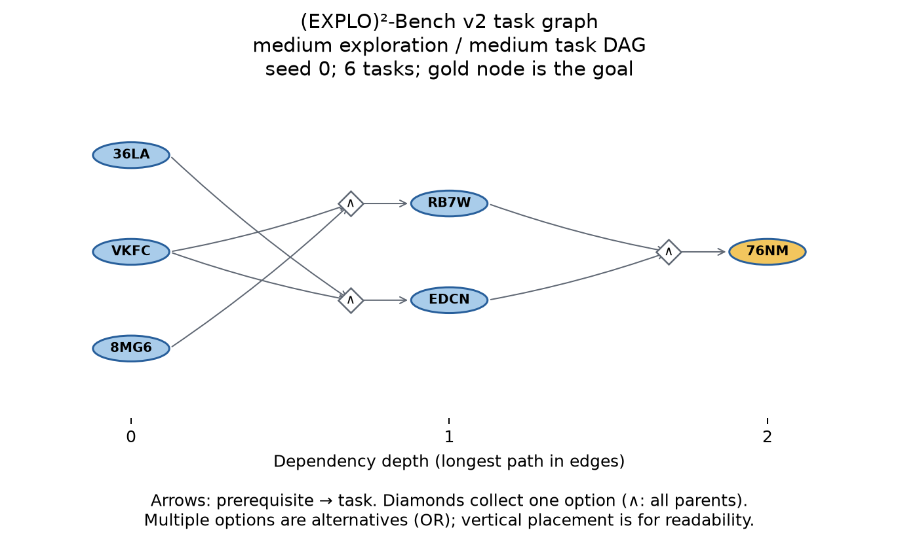

# (EXPLO)²-Bench

**(EXPLO)²-Bench** provides fixed benchmarks for evaluating how agents explore
partially observable environments and use the information they discover. This
repository includes (EXPLO)²-Bench v2 and (EXPLO)²-Bench v3 map collections, an
agent interface, eight reference baselines, and reproducible map and baseline
analyses.

The benchmarks build on the
[measurable-explore-exploit framework](https://github.com/jjj-madison/measurable-explore-exploit).
Exploration and exploitation error scoring uses its implementation directly,
with an upstream revision pinned in [the package dependencies](pyproject.toml).
The upstream repository provides the framework and metric definitions; this
repository provides the fixed benchmark collections and their baseline evaluation.

| Benchmark | Exploration-demand × task-DAG settings | Maps per setting | Total maps |
|---|---:|---:|---:|
| (EXPLO)²-Bench v2 | 5 × 5 | 10 | 250 |
| (EXPLO)²-Bench v3 | 9 × 9 | 100 | 8,100 |

Complete maps, generation settings, exact seeds, and checksums are included in
the repository and Python wheel. The two versions have distinct generation and
sampling procedures; their profile names do not imply matched maps or measured
agent difficulty. See the [benchmark definitions](docs/benchmark.md).

## Environment design

An agent moves through a partially observable 2D grid to discover task nodes
and their dependencies. These dependencies form a directed acyclic graph (DAG)
with AND/OR prerequisites. The agent uses information from past encounters to
activate tasks and complete the goal. A task activates at its cell when its
prerequisites are satisfied, so a task discovered early may require a later
revisit.

Exploration-demand settings control the space to explore; task-DAG settings
control the dependency structure. The following (EXPLO)²-Bench v2 example has
**44 open cells and six task nodes**, including the goal. These are complete
views for human inspection; evaluated agents receive partial observations.



The grid shows traversable cells, walls, task locations, and the starting cell
for `v2-medium-medium-s0`.



The matching task DAG shows which prerequisites must be activated before each
task. Task names match the grid above.
Explore more [(EXPLO)²-Bench v2 examples](analysis/maps/v2/examples/README.md) and
[(EXPLO)²-Bench v3 examples](analysis/maps/v3/examples/README.md).

## Try an agent

Install Python 3.10+ with pip and Git. An isolated Python environment is
recommended. From the repository root, install the package and run the examples
using your chosen interpreter. The commands below use `python`; substitute
`python3` if that is its name on your system.

```bash
python -m pip install .
python examples/custom_agent.py --version v2
python examples/lm_agent.py --version v3
```

Dependencies are declared in [pyproject.toml](pyproject.toml). Installation uses
Git to obtain the pinned upstream metric dependency. See the
[reproduction guide](docs/reproduce.md) for analysis dependencies, editable
installation, validation, and package builds.

The language-model (LM) example uses a dummy callback. Replace it with your model
client to evaluate an LM agent. The example and the eight reference baselines
make no model calls.

```python
from explo2_bench import load_benchmark, make_env, score_episode

record = next(load_benchmark("v3"))
env = make_env(record, alpha=2)
observation = env.reset()
while not env.done:
    action = {"move": observation["legal_moves"][0]}
    result = env.step(action)
    observation = result.observation
print(score_episode(env))  # Evaluator-only results after termination
```

Only pass the returned observations to evaluated agents. Complete records contain
privileged maps, generation seeds, and saved successful routes that verify
(EXPLO)²-Bench v3 maps can be completed.
See the [LM-agent protocol](docs/lm-agents.md) for action parsing, observation
history, failure handling, and isolation limits.

## Baseline evaluation and analysis

Baseline evaluation measures task success, exploration and exploitation errors,
action use, grid coverage, and planning cost. These measurements describe how
agents discover task nodes, use known dependencies, and spend their action
budgets. The [baseline reports](analysis/baselines/README.md) include separate
error rates and curves across ten action-budget multipliers.

The allowance is `B = floor(alpha × open_cells)` for
`alpha = [0.5, 1, 1.5, 2, 3, 4, 5, 6, 8, 10]`. Planning limits stay fixed across
these cutoffs. Structural map analysis measures the complete grids and task DAGs
independently of agent trajectories and action budgets.

- [Benchmark definitions and data format](docs/benchmark.md).
- [(EXPLO)²-Bench v2 map analysis](analysis/maps/v2/README.md) and
  [(EXPLO)²-Bench v3 map analysis](analysis/maps/v3/README.md), including per-map
  statistics, profile summaries, map/DAG examples, and separate PNG/PDF figures.
- [Structural metric definitions](docs/map-analysis.md) and diversity audits.
- [Eight baseline methods and evaluation protocol](docs/baselines.md), with
  [evaluation configuration](configs/baselines.json).
- [Reproduction commands](docs/reproduce.md) and [canary policy](CANARY.md).

## Dataset splits and reproducibility

The map collections have the following split assignments:

| Benchmark | Training | Validation | Test | Unassigned |
|---|---:|---:|---:|---:|
| (EXPLO)²-Bench v2 | 0 | 0 | 250 | 0 |
| (EXPLO)²-Bench v3 | 180 | 60 | 360 | 7,500 |

`load_benchmark(version)` loads the complete collection. Pass `split="test"`
to select its test maps. Unassigned maps have no designated training,
validation, or test role. See the [split definitions](docs/benchmark.md#split-memberships)
for selection examples and reporting requirements.

The included generator, settings, and seeds reproduce the released maps.
Checksums identify their contents and support validation; the
[reproduction guide](docs/reproduce.md) provides the commands. Dataset sources
and validation details are documented in
[dataset provenance](docs/benchmark.md#dataset-provenance).

All maps and seeds are public, so report which maps were used for training,
development, and evaluation. The [canary markers](CANARY.md) help identify
benchmark material in datasets, but cannot certify that evaluation maps were
unseen during training.

## License

The implementation is distributed under the [MIT license](LICENSE).
