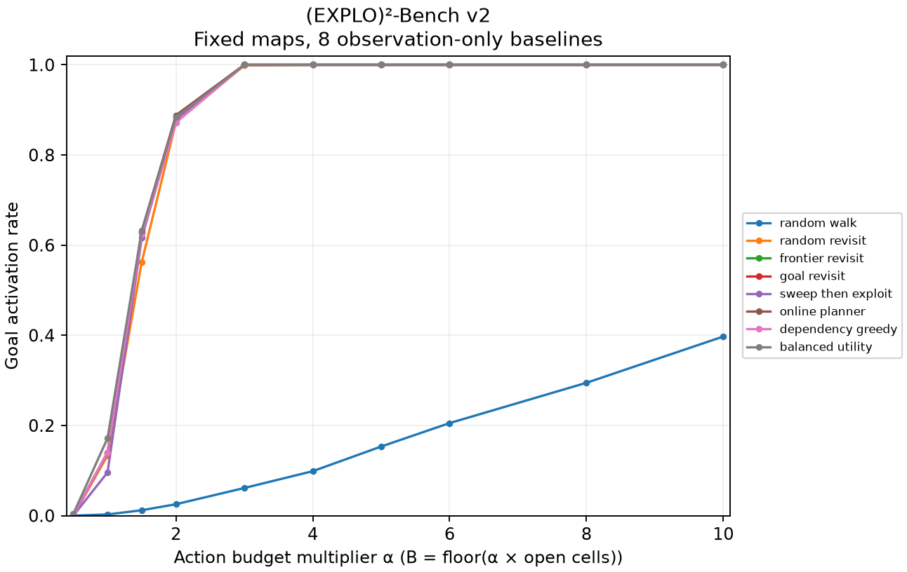
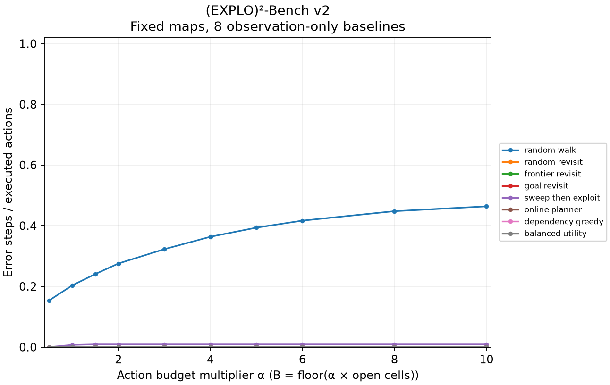

# (EXPLO)²-Bench v2 baseline analysis

Reference baselines explore partially observable grids, discover task nodes and their dependencies, and use that knowledge to activate the goal. We measure task success, exploration and exploitation errors, action use, grid coverage, and planning cost across action budgets.

This report covers **250 maps** and **30,000 budget rows**. Each row reports one map, policy, policy replicate, and action budget. The action-budget multipliers are 0.5, 1, 1.5, 2, 3, 4, 5, 6, 8, 10, with `B = floor(alpha × open_cells)`. Each cutoff is scored from the same trajectory for a map, method, and policy seed; policies cannot see the allowance.

Stochastic methods use 3 policy replicates per map. Each planning search is capped at 10,000 generated states. Policy CPU and wall time include reset and action selection and exclude environment transitions and scoring.

## Results at α = 10

| Method | Success rate | Actions to success | Successful maps / runs | Coverage | Union error rate | Policy CPU seconds |
|---|---:|---:|---:|---:|---:|---:|
| random walk | 0.397 | 334.1 | 149 / 298 | 0.939 | 0.464 | 0.0006 |
| random revisit | 1.000 | 66.4 | 250 / 750 | 0.942 | 0.001 | 0.0025 |
| frontier revisit | 1.000 | 63.0 | 250 / 250 | 0.947 | 0.000 | 0.0006 |
| goal revisit | 1.000 | 63.1 | 250 / 250 | 0.947 | 0.000 | 0.0023 |
| sweep then exploit | 1.000 | 64.7 | 250 / 250 | 0.993 | 0.009 | 0.0016 |
| online planner | 1.000 | 62.9 | 250 / 250 | 0.947 | 0.000 | 0.0024 |
| dependency greedy | 1.000 | 63.3 | 250 / 250 | 0.947 | 0.000 | 0.0033 |
| balanced utility | 1.000 | 62.9 | 250 / 250 | 0.934 | 0.001 | 0.0048 |

Rates are fractions between 0 and 1. Replicates are averaged within maps, maps within each exploration-demand/task-DAG setting, and settings equally. Actions to success excludes failures and averages only contributing maps/settings; compare it together with success rate. Its successful-map and run counts are shown explicitly. Error rates with no eligible actions are missing and excluded from that metric's mean.

## Exploration and exploitation errors at α = 10

Separate error rates describe exploration and the use of acquired knowledge. The metric classifies each action according to what the agent has discovered and which tasks are ready. Eligible actions are those included in a rate's denominator; some actions count toward both rates. Actions taken while the goal is ready to activate count only toward exploitation. The upstream [metric implementation](https://github.com/jjj-madison/measurable-explore-exploit) defines per-action errors; the [baseline protocol](../../../docs/baselines.md#measurements) specifies the action categories and denominators.

| Method | Exploration error rate | Exploitation error rate |
|---|---:|---:|
| random walk | 0.454292 | 0.433444 |
| random revisit | 0.000127 | 0.001761 |
| frontier revisit | 0.000000 | 0.001479 |
| goal revisit | 0.000000 | 0.000838 |
| sweep then exploit | 0.000000 | 0.033927 |
| online planner | 0.000000 | 0.000838 |
| dependency greedy | 0.000000 | 0.000838 |
| balanced utility | 0.000067 | 0.002942 |

These rates average map-level rates rather than pooling counts across trajectories. They are shown to six decimal places; an em dash indicates no contributing actions. Union error counts an action once when either or both error types occur and divides by executed actions, so it is not the sum of the two rates above.

## Aggregation and result checks

[Per-setting results](by_setting.csv) and [overall results](summary.csv) include contributing counts and normal-approximation 95% intervals based on within-setting map variation. These intervals describe variation across the fixed maps under an independence assumption; they do not certify generalization. Small cells and repeated structural components limit that approximation, and all-success/all-failure cells yield zero estimated variance. The fixed-inventory means themselves are exact.

See the [complete compressed result table](results.jsonl.gz), [run configuration and checksums](run.json), and [aggregation definitions](summary.json). Result hashes, inventory counts, and all expected method/budget/replicate combinations were checked before aggregation. See [result provenance and validation](../../../docs/baselines.md#result-provenance-and-validation) for the pinned scoring implementation and the checks applied to the included results.

The [upstream metric audit](../metric-audit.json) checked all **30,000 recorded rows** and **6,240 error-rate summary means** for this result file. It replayed **300 trajectories** on **25 selected maps**, covering **3,000 budget rows**, with agreement in all compared non-timing fields. Timing fields are excluded from replay comparisons.

Trajectory replay covers the sample listed in the audit; the remaining trajectories have not been replayed. The arithmetic and summary checks cover the full saved result table.

## Budget curves

The curves show how measured behavior changes as the action allowance increases. Each plot is a separate panel with PNG and PDF exports. Rate plots share the 0–1 scale.

Task success means activating the goal within the allowance. Each point averages the fixed maps using the protocol above.

Union error combines exploration and exploitation error indicators per action. Interpret this curve alongside task success: a low error rate alone does not establish that the goal was completed.

Additional measurements:

- [Grid coverage](figures/coverage.png).
- [Task activation](figures/activated_fraction.png).
- [Planning CPU cost](figures/planning_cpu_seconds.png).
- [Generated planning states](figures/search_states_generated.png).
