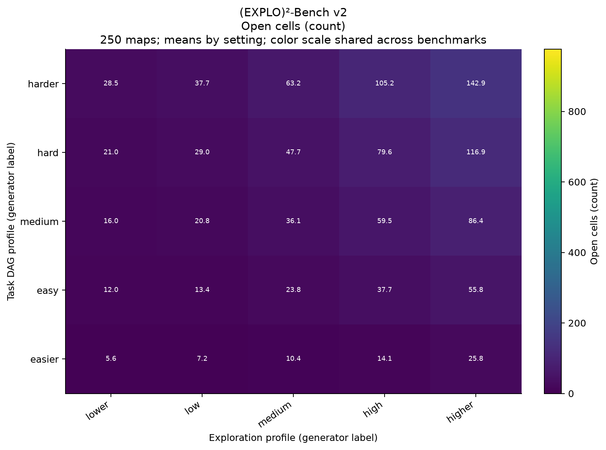
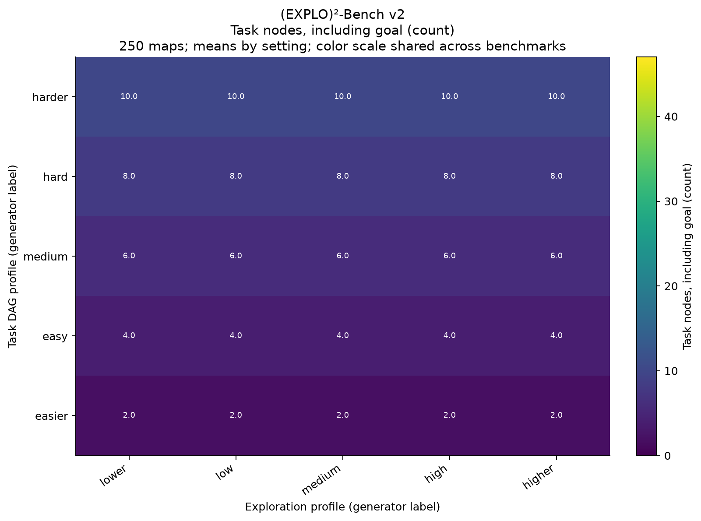

# (EXPLO)²-Bench v2 map analysis

Agents explore a partially observable 2D grid to discover task nodes and their dependencies, then use the knowledge acquired through past encounters to complete the goal. The maps vary both the space to explore and the structure of the task dependencies.

This report describes all **250 fixed maps** in (EXPLO)²-Bench v2. Structural measurements use the complete maps and task DAGs and are independent of action budgets and agent behavior. See the [map and task-DAG examples](examples/README.md) for complete views of individual environments.

## Environment structure

Open cells are traversable grid cells. Task nodes include the goal, and their prerequisites form a directed acyclic graph (DAG). Exploration-demand and task-DAG difficulty profiles specify the generator settings used to construct each map.

| Structural measurement | Minimum | Mean | Maximum |
|---|---:|---:|---:|
| Open cells (count) | 5.00 | 43.85 | 174.00 |
| Task nodes, including goal (count) | 2.00 | 6.00 | 10.00 |
| Task-dependency edges (count) | 1.00 | 8.16 | 23.00 |
| Longest dependency path (edges) | 1.00 | 2.20 | 6.00 |
| Largest dependency layer (nodes) | 1.00 | 2.60 | 3.00 |
| Grid dead ends (count) | 0.00 | 1.75 | 7.00 |
| Grid junctions (count) | 0.00 | 33.36 | 165.00 |
| Independent grid cycles (count) | 0.00 | 25.40 | 133.00 |
| Start-to-goal distance (moves) | 2.00 | 6.47 | 19.00 |
| Mean task-pair distance (moves) | 2.00 | 6.17 | 13.13 |

## Structural diversity

There are **250 distinct gameplay records**, **249 wall layouts**, and **31 task-DAG classes** under the documented equivalence definitions.

Gameplay identity compares the grid, starting cell, task names and placements, and dependencies, while excluding generation metadata and action budgets. Wall-layout identity compares grid dimensions and blocked cells. Task-coordinate sets compare occupied task cells, ignoring walls and task identities. Task-DAG classes group equivalent goal and AND/OR dependency structures, ignoring task names and spatial positions.

These counts describe map and task structure. Profile names identify generator settings and do not establish increasing difficulty for an agent. Dependency depth includes all prerequisite alternatives, so it does not give the minimum number of tasks needed to activate the goal. Spatial distances do not account for activation order.

See [metric definitions](../../../docs/map-analysis.md), [per-map data](per_map.csv), [setting summaries](by_profile.csv), [diversity results](diversity.json), and [provenance checksums](manifest.json).

## Figures

Each heatmap shows the mean measurement across maps at a pair of exploration-demand and task-DAG difficulty profiles. The axes name generator settings; the colors describe measured structure. Each panel has separate PNG and PDF exports, with common scales across (EXPLO)²-Bench v2 and (EXPLO)²-Bench v3.

### Space to explore

Open cells measure the traversable space in each map. Comparing profile pairs shows how the amount of space available for exploration changes across the benchmark.

### Task dependencies

Task-node counts describe the size of the dependency graph. The prerequisite structure also matters: node count alone does not determine the work required to activate the goal.

### Additional structural measurements

- [Independent grid cycles (count) by profile](figures/cycle_rank_heatmap.png).
- [Longest dependency path (edges) by profile](figures/dag_depth_heatmap.png).
- [Prerequisite groups with ≥2 parents (count) by profile](figures/and_groups_heatmap.png).
- [Mean task-pair distance (moves) by profile](figures/task_pair_distance_mean_heatmap.png).
- [Open cells (count) distribution](figures/open_cells_distribution.png).
- [Mean task-pair distance (moves) distribution](figures/task_pair_distance_mean_distribution.png).
