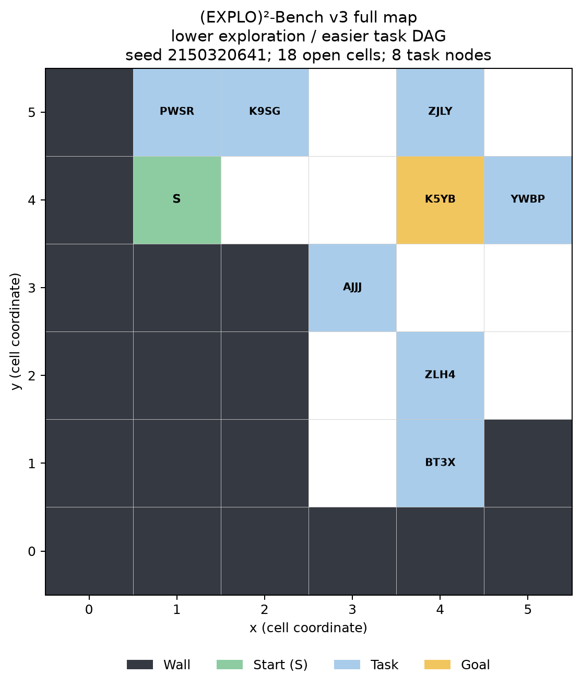
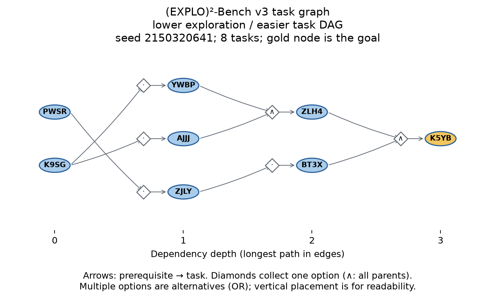
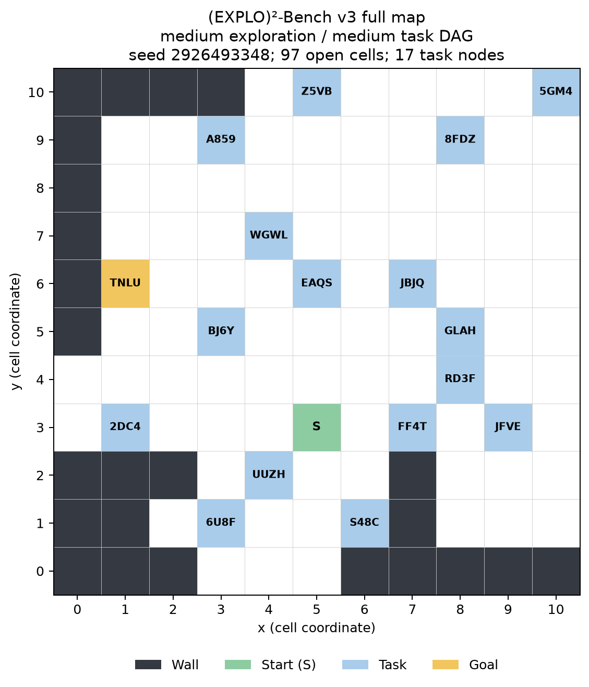
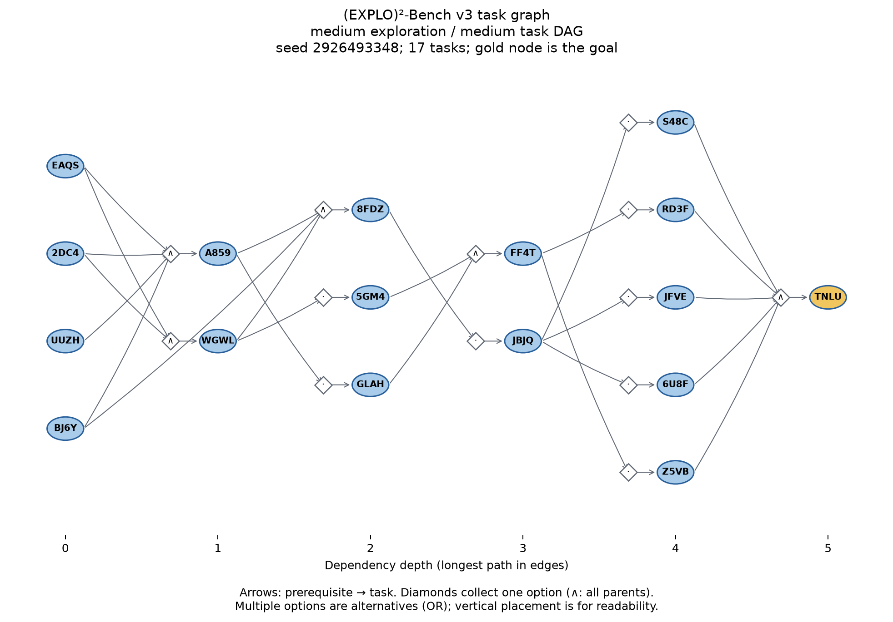
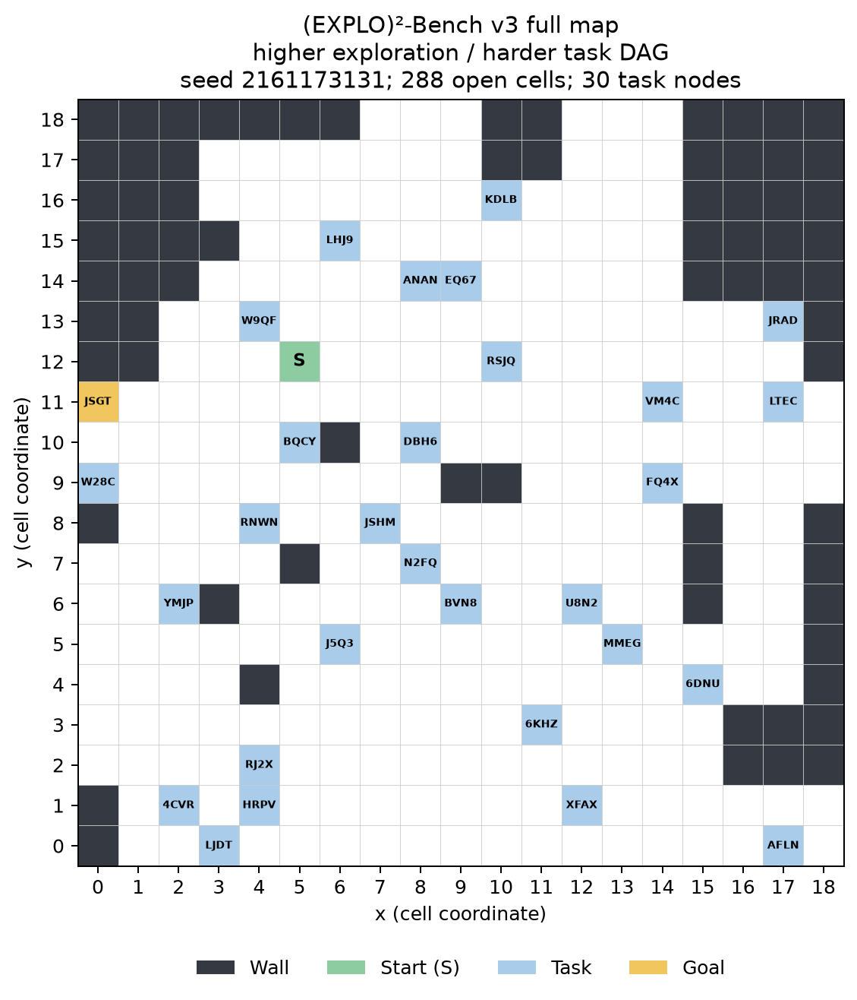
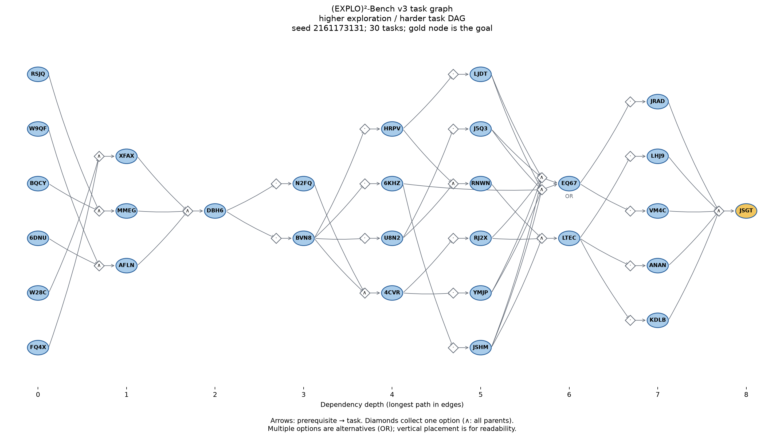

# (EXPLO)²-Bench v3 map and task-DAG examples

An agent discovers task nodes as it moves through a partially observable 2D grid. It uses the task dependencies learned through these encounters to satisfy prerequisites and activate the goal. Each example below shows a complete map and its matching task DAG, with the same visible task names in both panels.

These complete views are for human inspection. Evaluated agents receive partial observations, not the full map or task graph. Examples use the first seed listed in the benchmark's seed table at each of three named settings, without selecting for appearance or success. The profile names identify generator settings rather than measured agent difficulty.

In the maps, dark cells are walls, green marks the start, blue marks task locations, and gold marks the goal. In the DAGs, arrows run from prerequisite to dependent task. A diamond groups prerequisites that must all be satisfied (AND); separate groups provide alternatives (OR).

## Lower exploration demand · Easier task DAG

Map `v3-lower-easier-s2150320641` · generation seed `2150320641`.

The complete grid shows the traversable space, task locations, start, and goal.

The matching DAG shows which task prerequisites must be satisfied before the goal can activate.

## Medium exploration demand · Medium task DAG

Map `v3-medium-medium-s2926493348` · generation seed `2926493348`.

The complete grid shows the traversable space, task locations, start, and goal.

The matching DAG shows which task prerequisites must be satisfied before the goal can activate.

## Higher exploration demand · Harder task DAG

Map `v3-higher-harder-s2161173131` · generation seed `2161173131`.

The complete grid shows the traversable space, task locations, start, and goal.

The matching DAG shows which task prerequisites must be satisfied before the goal can activate.

See the [map analysis](../README.md) for the full benchmark's structural measurements and the [example manifest](manifest.json) for map identities and checksums.
